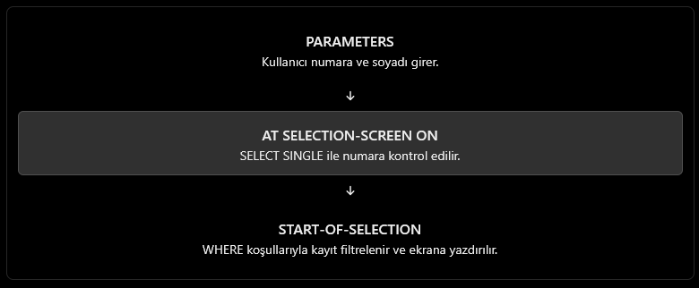

# ABAP Screen Processing – Selection Screen

# ABAP Ekran İşlemleri – Seçim Ekranı

## 1. ENGLISH EXPLANATION

### 1.1. Report and Table Declaration

```abap
REPORT z_screens_1.

TABLES: zemployees.

DATA: wa_employee LIKE zemployees-employee.
```

- `REPORT z_screens_1`: Defines the ABAP report program.
- `TABLES zemployees`: Declares a table work area associated with the `zemployees` table.
- `DATA wa_employee LIKE zemployees-employee`: Creates a variable with the same data type as the `employee` field.

**Important:** `wa_employee` stores only the employee number, not the complete employee record.

### 1.2. PARAMETERS – Creating Input Fields

```abap
PARAMETERS: my_ee LIKE zemployees-employee
            DEFAULT '4234234234' OBLIGATORY,
            my_syn LIKE zemployees-surname
            DEFAULT 'BORGES' LOWER CASE.
```

`PARAMETERS` creates input fields on the selection screen. The user can enter values before executing the report.

- `my_ee`: An input parameter for the employee number.
- `LIKE zemployees-employee`: Uses the data type of the employee field.
- `DEFAULT '4234234234'`: Sets an initial default value.
- `OBLIGATORY`: Makes the field mandatory. The user must enter a value before executing the report.
- `my_syn`: An input parameter for the surname.
- `DEFAULT 'BORGES'`: Sets the default surname to `BORGES`.
- `LOWER CASE`: Allows lowercase letters to be entered and preserved in the parameter.

**Note:** A default value does not mean that the employee exists in the database. It only fills the input field initially.

### 1.3. INITIALIZATION – Setting Initial Values

```abap
INITIALIZATION.
```

The `INITIALIZATION` event runs before the selection screen is displayed. It is commonly used to set or modify initial values of selection-screen parameters.

In this program, the parameters already have default values, so no additional initialization code is necessary.

### 1.4. SELECT – Reading Employee Records

```abap
SELECT * FROM zemployees.

  wa_employee = zemployees-employee.

  WRITE: / wa_employee.
  WRITE: / zemployees-employee, zemployees-surname.

ENDSELECT.
```

- `SELECT * FROM zemployees`: Reads employee records from the database table.
- `wa_employee = zemployees-employee`: Copies the current employee number into the variable.
- `WRITE: / wa_employee`: Displays the employee number on a new line.
- `WRITE: / zemployees-employee, zemployees-surname`: Displays the employee number and surname on a new line.
- `ENDSELECT`: Ends the database selection loop.

**Important:** This SELECT statement reads all employee records because it has no `WHERE` condition. It does not filter the results using `my_ee` or `my_syn`.

### 1.5. AT SELECTION-SCREEN ON – Validating an Input

```abap
AT SELECTION-SCREEN ON my_ee.

  IF my_ee > wa_employee.
    WRITE: 'Wrong enter bunber'.
  ENDIF.
```

`AT SELECTION-SCREEN ON my_ee` is an event that runs when the user processes the selection screen and the `my_ee` field is checked.

The IF statement compares two values:

- `my_ee`: The employee number entered by the user.
- `wa_employee`: The value currently stored in the variable.

The operator `>` means **greater than**.

However, this comparison does not check whether the entered employee number exists in the database. Also, `wa_employee` is assigned inside the SELECT loop, so it may contain the last employee number read when this event is executed. The SELECT loop in `INITIALIZATION` is not a reliable way to validate the user's input.

`WRITE` is also not the appropriate way to report a selection-screen validation error. A message such as `MESSAGE ... TYPE 'E'` is generally used for this purpose.

---

## 2. TÜRKÇE AÇIKLAMA

### 2.1. Rapor ve Tablo Tanımlama

```abap
REPORT z_screens_1.

TABLES: zemployees.

DATA: wa_employee LIKE zemployees-employee.
```

- `REPORT z_screens_1`: ABAP rapor programını tanımlar.
- `TABLES zemployees`: `zemployees` tablosuyla ilişkili bir çalışma alanı tanımlar.
- `DATA wa_employee LIKE zemployees-employee`: `employee` alanıyla aynı veri tipine sahip bir değişken oluşturur.

**Önemli:** `wa_employee`, çalışanın bütün bilgilerini değil, yalnızca çalışan numarasını tutar.

### 2.2. PARAMETERS – Giriş Alanları Oluşturma

```abap
PARAMETERS: my_ee LIKE zemployees-employee
            DEFAULT '4234234234' OBLIGATORY,
            my_syn LIKE zemployees-surname
            DEFAULT 'BORGES' LOWER CASE.
```

`PARAMETERS`, seçim ekranında kullanıcının veri girebileceği alanlar oluşturur.

- `my_ee`: Çalışan numarası girmek için kullanılır.
- `LIKE zemployees-employee`: Çalışan numarası alanının veri tipini referans alır.
- `DEFAULT '4234234234'`: Alana başlangıç değeri verir.
- `OBLIGATORY`: Alanı zorunlu yapar. Kullanıcı bu alana değer girmeden raporu çalıştıramaz.
- `my_syn`: Soyadı girmek için kullanılır.
- `DEFAULT 'BORGES'`: Soyadı alanına varsayılan olarak `BORGES` değerini koyar.
- `LOWER CASE`: Kullanıcının küçük harf girmesine ve bu harflerin korunmasına izin verir.

**Önemli:** `DEFAULT` ile bir değer vermek, bu çalışanın veritabanında bulunduğu anlamına gelmez. Yalnızca giriş alanına başlangıç değeri yerleştirir.

### 2.3. INITIALIZATION – Başlangıç Değerlerini Ayarlama

```abap
INITIALIZATION.
```

`INITIALIZATION` olayı, seçim ekranı kullanıcıya gösterilmeden önce çalışır. Genellikle parametrelere başlangıç değerleri vermek veya mevcut başlangıç değerlerini değiştirmek için kullanılır.

Senin programında parametrelerin zaten `DEFAULT` değerleri var. Bu nedenle ayrıca bir başlangıç işlemi yapman gerekmiyor.

Ayrıca, bütün çalışanları okuyan `SELECT` döngüsünü `INITIALIZATION` içine koymak doğru bir tasarım değildir. Bu işlem raporun ana çalışma bölümünde yapılmalıdır.

### 2.4. SELECT – Çalışan Kayıtlarını Okuma

```abap
SELECT * FROM zemployees.

  wa_employee = zemployees-employee.

  WRITE: / wa_employee.
  WRITE: / zemployees-employee, zemployees-surname.

ENDSELECT.
```

- `SELECT * FROM zemployees`: Veritabanındaki çalışan kayıtlarını okur.
- `wa_employee = zemployees-employee`: O an okunan çalışanın numarasını değişkene aktarır.
- `WRITE: / wa_employee`: Çalışan numarasını yeni satırda gösterir.
- `WRITE: / zemployees-employee, zemployees-surname`: Çalışan numarasını ve soyadını yeni satırda gösterir.
- `ENDSELECT`: SELECT döngüsünü bitirir.

**Önemli:** Bu sorguda `WHERE` olmadığı için tablodaki bütün çalışan kayıtları okunur. Kullanıcının `my_ee` veya `my_syn` alanına girdiği değerler filtreleme amacıyla kullanılmaz.

### 2.5. AT SELECTION-SCREEN ON – Giriş Alanını Kontrol Etme

```abap
AT SELECTION-SCREEN ON my_ee.

  IF my_ee > wa_employee.
    WRITE: 'Wrong enter bunber'.
  ENDIF.
```

`AT SELECTION-SCREEN ON my_ee`, kullanıcı seçim ekranını işlediğinde `my_ee` alanını kontrol etmek için çalışan bir olaydır.

Burada iki değer karşılaştırılır:

- `my_ee`: Kullanıcının girdiği çalışan numarası.
- `wa_employee`: Değişkende o anda bulunan değer.

`>` operatörü **büyüktür** anlamına gelir.

Örneğin:

```abap
IF my_ee > wa_employee.
```

Bu ifade, `my_ee` değerinin `wa_employee` değerinden büyük olup olmadığını kontrol eder.

Ancak bu karşılaştırma, çalışanın veritabanında kayıtlı olup olmadığını göstermez. Çünkü `wa_employee`, SELECT döngüsünde okunan son çalışanın numarasını tutuyor olabilir.

Ayrıca `WRITE` komutu seçim ekranında hata bildirmek için uygun yöntem değildir. Bu tür bir kontrol için genellikle `MESSAGE ... TYPE 'E'` kullanılır.

---

## 3. IMPROVED EXAMPLE – GELİŞTİRİLMİŞ ÖRNEK

Aşağıdaki örnek, kullanıcının girdiği çalışan numarasının tabloda bulunup bulunmadığını kontrol eder ve yalnızca eşleşen çalışanı listeler.

```abap
REPORT z_screens_1.

TABLES: zemployees.

PARAMETERS: my_ee LIKE zemployees-employee
            DEFAULT '4234234234' OBLIGATORY,
            my_syn LIKE zemployees-surname
            DEFAULT 'BORGES' LOWER CASE.

DATA: wa_employee LIKE zemployees-employee.

AT SELECTION-SCREEN ON my_ee.

  SELECT SINGLE employee
    FROM zemployees
    WHERE employee = @my_ee
    INTO @wa_employee.

  IF sy-subrc <> 0.
    MESSAGE 'Employee number not found' TYPE 'E'.
  ENDIF.

START-OF-SELECTION.

  SELECT *
    FROM zemployees
    WHERE employee = @my_ee
      AND surname = @my_syn.

    WRITE: / zemployees-employee,
             zemployees-surname.

  ENDSELECT.
```

### Explanation / Açıklama

- `SELECT SINGLE`: Eşleşen tek bir çalışan numarasını arar.
- `WHERE employee = @my_ee`: Veritabanındaki çalışan numarasını kullanıcının girdiği numarayla karşılaştırır.
- `sy-subrc <> 0`: Kayıt bulunamadığında koşul doğru olur.
- `MESSAGE ... TYPE 'E'`: Seçim ekranında hata mesajı gösterir ve kullanıcının girişi düzeltmesini sağlar.
- `START-OF-SELECTION`: Raporun ana işlem bölümünü başlatır.
- `AND surname = @my_syn`: Çalışan numarasına ek olarak soyadının da eşleşmesini ister.

**Final note / Son not:** `@` işareti modern ABAP Open SQL sözdiziminde program değişkenlerini belirtir. Eski ABAP sürümlerinde uygun eski sözdizimini kullanman gerekebilir. Ayrıca çalışan numarası alanının uzunluğu ve örnek varsayılan değerin geçerliliği, senin `zemployees` tablonun tanımına bağlıdır.

## Selection Screen Flow


